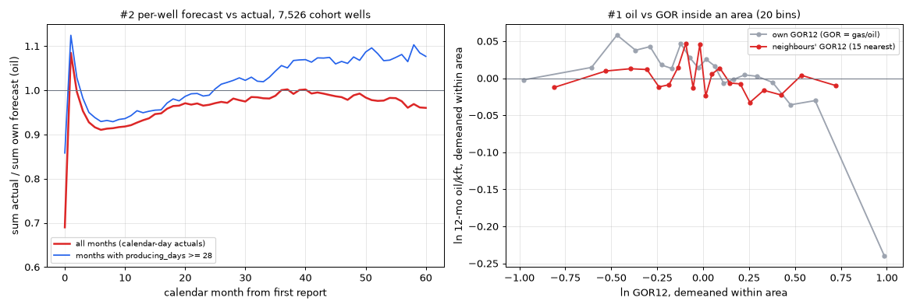

# BOX step 5b — baseline type curves per WCA TC area (gate 5b summary)

Built 2026-10-10 on branch `claude/box-step5b-curves`. Read-only against the warehouse. **Nothing stored**:
the `box.type_curve` / `tc_member` / `risk_factor` DDL is step 5d (go-apply), and dev-scenario factors are 5c.

**Review surface:** `curves_WCA.html`. Serve with `python -m http.server 8766 --directory docs/box` (or the
`box-static` launch config), then open `/step5b-2026-10-10/curves_WCA.html`. It has the area map (click an
area to jump to its card), the area table, the three gate-question sections, and one card per area with oil /
gas / water fit overlays and the member list.

## 1. What exists

| File | What |
|---|---|
| `curves_WCA.html` | The review page. |
| `areas_WCA.csv` | One row per area: n per stream, ladder rung, record oil params (qi, nominal Di + 1-yr effective, b), EUR/1,000 ft for the mean and P50 fits, gas (ratio) EUR + 12-mo GOR (as fitted and at the area's own GOR), water, curve-vs-actual 12-mo cum, worst reconcile gap, vintage, top operator. |
| `curves_WCA.csv` | Every fit: area × stream × statistic (mean, P50) × mode (oil/water Arps, gas ratio + gas Arps diagnostic), plus the basin pool row (`area_no = pool`). |
| `members_WCA.csv` | The strict cohort per area (shape of `box.tc_member`): sub-bench under both tag views, per-well oil EUR/kft, b, Di, at-bound flag, 12-mo oil/kft, GOR12, included / drop reason. |
| `well_fits_WCA.csv` | Per-well params and EUR for all 12,241 wells fitted (every ladder candidate). |
| `subbench_WCA.csv`, `gor_split_WCA.csv`, `gas_level_WCA.csv` | Data behind the three gate questions. |
| `anduin_check.json` | The §7 equivalence check against anduin. |
| `summary.json` | Run stamp, identities, every headline number below. |

Code: `box/tc_curve.py` (pure curve math on top of `blueox-boxfit`), `box/tc_curve_report.py` (inputs,
per-well fits, ladder, gate tests, page), `scripts/box_tc_curves.py` (CLI, ~7 min), `scripts/box_tc_anduin_check.py`
(§7 check), `tests/test_box_tc_curve.py` (12 DB-free tests). **`blueox-boxfit` is pinned** in
`requirements-dealintake.txt` at the merged anduin SHA `b7a051958d15…` by git URL (never by bare name). CI
installs that file, so the engine is installed in CI too.

## 2. Inputs

- **Areas:** `box.tc_area` v1 (record) on extent 6, 35 areas. Membership by lateral midpoint was checked by
  identity against the step-4 `wells_area_WCA.csv`: all 7,527 cohort wells are in the same area. The run
  refuses on any mismatch.
- **Wells:** gate-1 `wells_final_WCA.csv` minus `exclusions.csv` (27 wells). The strict cohort is the step-4
  D9 12-mo cohort (7,527 wells).
- **Production:** `curated.production` (the same columns anduin syncs), cut at **2026-07-01**, the last fully
  reported month. August carries 34k rows against July's 63k, so fitting it would read reporting lag as decline.
- **Fits:** `boxfit.well.fit_well_streams` with default `ForecastConfig`. That is anduin's autoforecast: own-peak
  anchoring per stream, oil/gas nominal Di ∈ [0.5, 4.0]/yr, water cap 12/yr, b ∈ [0.9, 1.2], b prior keyed on
  sub-basin + formation_blueox, Delaware Df 0.08. Wells with a fit in the cohort: oil 7,526, gas 7,524, water 7,501.

## 3. Method

1. **Panel.** Each member well's ramp + Arps forecast on the 600-month grid, peak_ramp aligned (each stream's peak
   slid to the cohort-median ramp length), per 1,000 ft of lateral.
2. **Aggregate.** `boxfit.tc.aggregate` gives the cross-well P10…P90 (SPE: P10 = HIGH) and the mean for each month.
3. **Fit.** `fit_p50_series` fits ramp + modified-hyperbolic Arps to a series. It is anduin's TC fitter, applied
   here to both the mean and the P50.
4. **Gas (D30).** Ratio mode: ln GOR = α + β·Np, fitted on the mean gas / mean oil series against cumulative mean
   oil, then applied to the record oil curve. `shift_gor_level` moves α so that the curve's 12-mo GOR equals a
   location's local GOR12, and keeps β. Np stays per 1,000 ft: a PUD's ratio against time equals the curve's, so the
   lateral rescale cancels.
5. **Water.** Independent Arps on the mean series.
6. **Ladder (D10).** Pools are fixed and stamped per curve: (1) strict D9 cohort in the area → (2) any lateral,
   first prod ≥ 2016, 12 full months → (3) rung 2 with no vintage floor → (4) strict cohort of the area plus its
   edge neighbours → (5) parent bench. A stream takes the first rung with ≥ 10 fitted wells. If no rung qualifies,
   it falls to rung 5 and is flagged `thin`.

**Curve of record = the cohort MEAN** (labelled mean, never P50). This settles the §9 item for 5b; Michael confirms
at gate 5. The reason: step 6 scores the mean per-well error, actual / predicted − 1 (the sql/43 convention). Only
the mean curve predicts the cohort's mean cum without a built-in skew bias. Across the 35 areas, the mean curve's
EUR is **1.065× the P50 fit's** (median; IQR 1.05–1.08; range 0.98–1.28). Both fits are stored in the CSVs and drawn
on every card.

## 4. Results

**Ladder:** all 35 areas sit at **rung 1 on every stream**. The smallest area has 15 fitted oil wells, the largest
1,810. Rungs 2–5 never fired for a record curve.

**Area oil EUR (mean curve, raw 50-yr):**

| | bbl per 1,000 ft |
|---|---|
| Median | 65,939 |
| IQR | 47,238 – 79,024 |
| Range | 27,375 (area 18, gassy W edge, 12-mo GOR 16,077) – 130,040 (area 12) |

Record oil Di runs 1.85 – 3.93 /yr nominal, which is **63 – 80 % 1-yr effective**. b runs 0.94 – 1.19; Df 0.08.

**Basin pool reference (7,526 wells):**

| Stream | Fit | EUR per 1,000 ft | Parameters |
|---|---|---|---|
| Oil | mean | 80,345 bbl | qi 136 bopd/kft, Di 3.14 /yr nominal = 75 % effective, b 1.04 |
| Oil | P50 | 75,101 bbl | |
| Gas | ratio, as fitted | 337,867 mcf | 12-mo GOR 3,672 scf/bbl |
| Water | mean | 355,648 bbl | Di 2.43 nominal = 69 % effective, b 1.15 |

The pool EUR sits above the area median because the big sweet-spot areas carry most of the wells.

**§7 checks:**

| Check | Result |
|---|---|
| BOX curve path = anduin's | **PASS.** Two saved curves whose members were never refit reproduce to ~1e-10: vault_wcxy (25 wells, WCA_1/WCA_2) and RALLYCAPS_WCB_2_N. vault_wca (201 wells) differs from its *stored* series by 1–2 %, because 548 of its 590 member forecasts were refit after it was saved (anduin's known "global refit doesn't mark stale" path; `is_stale` is still false). Against anduin's own code run today on the same forecasts, BOX agrees to 3e-10. |
| Per-well engine = anduin's | 1,084 cohort wells have an anduin machine fit. BOX matches anduin's stored EUR to < 0.1 % on 85 % of them (median difference 0.0) and to < 5 % on 96 %. The remainder is data drift since anduin's last sync and refit. |
| Stored vs recomputed EUR < 0.1 % (rule 6) | **FAIL as written: 54 of 216 Arps fits exceed 0.1 %, worst 0.20 %.** See flag (a). |
| Units / grain / conventions | Wells; per 1,000 ft; nominal + effective Di everywhere; mean vs P50 labelled; P10 = high. |

## 5. Gate questions (report, don't act)

**D19, WCA_1 vs WCA_2.** WCA_2 runs about 4 % below WCA_1 inside an area, consistently, and smaller than the
noise between areas.

| | tag view (WCXY → WCA_1) | consensus view (449 wells change sub-bench) |
|---|---|---|
| Well FE, per-well EUR/kft, WCA_2 vs WCA_1 | **−3.7 %** (t −4.7) | **−4.1 %** (t −5.2) |
| Well FE, 12-mo cum/kft | −3.5 % | −3.9 % |
| Curve EUR ratio WCA_1/WCA_2 (26 areas with both at rung 1) | median 1.04, IQR 0.97–1.09 | median 1.04, IQR 0.98–1.10 |
| Areas with an EUR gap > 10 % | 7 of 26 | 8 of 26 |

The consensus reassignment barely changes the answer. The split would put 9 areas' sub-bench curves on a
relaxed rung (2, 3 or 4). **My read: no split.** A ~4 % level difference is inside the area-to-area noise, and
splitting thins the curves. It is your call at gate 5.

**Do oil b / Di move with GOR inside an area?** Yes, mainly in level, a little in shape.

- **Well level** (within-area OLS on ln GOR12, 7,525 wells), across the GOR12 IQR:
  - b −0.025;
  - nominal Di +0.18 /yr, which is **+1.9 points of 1-yr effective decline**;
  - EUR/kft about −14 %.

  55 % of per-well b and 38 % of Di sit at a bound, which damps these slopes.
- **Curve level** (31 areas split at their median GOR12, ≥ 10 wells per half), high-GOR half minus low-GOR half:

  | | Median | IQR |
  |---|---|---|
  | b | −0.012 | |
  | Nominal Di | +0.09 /yr | |
  | 1-yr effective decline | +1.1 points | |
  | EUR, high / low | **0.89** | 0.79–0.94 |

  In 21 of the 31 areas the high-GOR half has the steeper Di.

So there is a case for a GOR split, and it is about **oil level**: the gassier half yields ~11 % less oil per ft
in the same area. Decline shape barely moves. Per the plan, this is reported only; no action taken.

**D30 gas level (held out).** For 6,960 cohort wells with 24 months, each well's local level comes from its 15
nearest *other* cohort wells' 12-mo GOR. R² of ln GOR:

| Predictor | GOR12 | GOR24 | GOR24 median actual / predicted |
|---|---|---|---|
| Area curve alone | 0.32 | 0.40 | 0.84 |
| **Local level × area shape (D30)** | 0.82 (local level) | **0.81** | **1.05** |
| Local level held flat | | 0.80 | 1.07 |

D30 works. The area shape adds a little over a flat local GOR.

## 6. Flags for Michael

a. **Rule-6 reconcile is above 0.1 % on steep curves.** It is pure quadrature: the 600-month monthly trapezoid
   overstates a convex curve, and the gap correlates 0.97 with Di. Median gap 0.09 %, worst 0.20 %, at Di ≈ 3.9–4.0
   /yr. anduin's own TC fits use the same code, so they behave the same way. CLAUDE.md's "< 0.1 %" holds only below
   about Di 3.5. **Nothing changed.** Options: accept ≤ 0.25 % for TC fits, or refine the trapezoid grid. The second
   is an anduin + export contract change.

b. **Early-time cum runs ~10 % high against calendar actuals.**

   | Comparison | 12-mo cum vs actual |
   |---|---|
   | Record oil curve vs members' mean actual (median across areas) | **+9.8 %** (IQR +7.7 to +12.4 %) |
   | Basin pool, oil | +9.2 % |
   | Basin pool, 24-mo cum | +6.4 % |
   | Per-well forecasts alone (calendar, no alignment) | +8 % (oil and gas both) |

   Most of the gap comes from the per-well fits, not from BOX's aggregation. anduin's fits trace a producing curve:
   downtime months are dropped and qi is anchored at 0.90–1.05 × peak. peak_ramp alignment adds about 1–2 points.
   Dropping the Di-pinned wells does not remove it (pool +7.4 %). **This is the biggest risk to step-6
   acceptance.** A +10 % curve predicts a bias of about −9 % on the sql/43 metric. That is inside ±10 % but with no
   margin. Decide at gate 5 whether step 6 scores the curve as-is or with a documented uptime / calendar treatment.

c. **37 % of cohort oil fits pin at Di = 4.0 /yr** (upper bound); another 38 % sit at b = 0.9. anduin flags at-bound
   fits for review and never auto-accepts them. BOX currently **keeps** them in the panel. Sensitivity: the pool
   curve without the Di-pinned wells (4,693 wells) gives 82,526 bbl/kft vs 80,345 (+2.7 %), Di 2.53 nominal (71 %
   effective) vs 3.14 (75 %). Keep or drop is your call. Widening the bounds is off the table per the house rule.

d. **The TC-level water fit uses the OIL Di bound.** `fit_p50_series` hard-codes `stream="oil"`, so a water curve
   caps at 4.0 /yr, not the 12 /yr water cap of rule 1. 5 areas' water curves pin at 4.0: areas 1, 2, 5, 8, 9. This
   is anduin's behaviour, inherited through the shared engine. It is not fixed here, because fixing it would move
   anduin's saved water curves.

e. **The gas ratio curve, as fitted, overstates early GOR.** Pool 12-mo GOR is 3,672 scf/bbl against an actual
   3,120. Pool gas cum-12 runs +28 %, where the gas Arps diagnostic runs +8.5 %. The log-linear fit over the full
   50-yr mean series overshoots early life. D30's level shift absorbs it at the location: each area's curve shifted to
   its own members' GOR runs +10 % on gas cum-12, the same as oil, because gas rides on the oil curve. Store the area's
   α and β, and treat α as a reference value that every location shifts.

f. **D10 rung 3 vs D26 conflict, not resolved here.** D10 rung 3 relaxes vintage, but D26 states that pre-2016 wells
   are "never curve evidence (D9)". No record curve reached rung 3. In the D19 sensitivity, rung 3 fired once
   (area 23 WCA_1: 7 strict wells, then 13 with the vintage floor dropped). Rule needed before step 7.

g. **anduin follow-up (not BOX).** vault_wca's stored series is stale against its current member forecasts
   (64,104 stored vs 65,286 bbl/kft recomputed, P50 oil) and `is_stale` is still false. This is the known loss path
   in CLAUDE.md.

## 7. Gate-5b asks

1. Accept the **mean** curve as the curve of record (vs P50).
2. D19: pool WCA_1 + WCA_2 (my read) or split.
3. GOR: note the ~11 % within-area oil-level effect. Act now (GOR split) or after the step-6 hindcast?
4. Flags a–f: reconcile tolerance, the +10 % early-cum treatment for step 6, at-bound wells keep / drop, the water
   bound, the rung-3 rule.

Next after the gate: **5c** dev-scenario factors (fresh session), then 5d DDL (go-apply).

## 8. Gate 5b outcome (Michael, 2026-10-11)

- **D32:** the cohort MEAN is the curve of record (ask 1).
- **D33:** WCA_1 + WCA_2 stay pooled — no sub-bench split (ask 2).
- **D34:** bound-pinned per-well fits stay in the panel for now (flag c).
- Not yet answered: the GOR oil-level effect (ask 3) and flags a, b, d, e, f — carried in plan §9.

## 9. Follow-up 2026-10-11: open items #1 (GOR oil level) and #2 (early cum)

Analysis: `scripts/box_tc_gate5b_dig.py` → `dig/dig.json`, `dig/dig.png`. Read-only. Grain = the 7,526 cohort wells
with an oil fit; production through 2026-07-01; each well's OWN anduin-style forecast laid on calendar months from
its first report (no peak_ramp alignment), against its actual monthly volumes.

### #1 — the within-area "GOR effect on oil" is a mechanical artifact. **Supersedes the §5 GOR reading.**

GOR12 = gas12 / oil12, so a well that under-produces oil reads a HIGH GOR by construction. Splitting an area at its
median OWN GOR (§5) sorted wells by their own oil residual, so the 0.89× was built in.

Test with the **neighbours' GOR** instead: the median 12-mo GOR of the 15 nearest other cohort wells, which has no
mechanical link to the well's own oil.

| Within-area slope of ln 12-mo oil/kft on… | Slope | t |
|---|---|---|
| own ln GOR12 | −0.107 | −12.7 |
| **neighbours' ln GOR12** | **−0.012 ± 0.011** | −1.1 (zero) |
| … + first-prod-year FE + TVD + ln lateral + top-25 operator FE | −0.010 ± 0.013 | (zero) |
| ln 12-mo **gas**/kft on neighbours' ln GOR12 | +0.999 | +83 |

Inside an area, gassier ground carries **the same oil and proportionally more gas**. On a blocked held-out test
(5 folds on 3-mi blocks), R² of ln 12-mo oil/kft:

| Predictor | R² |
|---|---|
| area mean | 0.441 |
| area mean + neighbours' GOR adjustment | 0.441 |
| local 15-well oil median | 0.268 |
| local oil median + neighbours' GOR | 0.276 |

GOR adds nothing on top of the area. These R² sit higher than step 4's 0.21 because the areas themselves were built
on all wells and only the area means are re-estimated per fold, so compare rows within this table, not across steps.

The one residue is per-well 50-yr oil EUR/kft on neighbours' ln GOR: −0.09 (t −8.7). That is a slightly steeper
decline in gassier ground; 12-mo oil is unaffected. Across the typical within-area spread of neighbours' GOR (IQR
0.25 ln units) it moves EUR by about **−2 %**, which is immaterial at area grain.

**Recommendation:** close the item. No GOR split, no GOR term on oil. D30 already handles gas through the local level.

### #2 — the curves run ~7 % high in year 1 against calendar actuals. Three causes, measured.

Sum actual / sum own forecast, oil:

| Window | Ratio | n wells |
|---|---|---|
| month 0 (first report) | 0.69 | 7,526 |
| cum-3 | 0.94 | 7,526 |
| cum-6 | 0.94 | 7,526 |
| **cum-12** | **0.93** | 7,526 |
| cum-24 | 0.94 | 6,961 |
| cum-36 | 0.94 | 6,068 |
| cum-60 | 0.96 | 4,106 |

Gas tracks oil: 0.94 / 0.93 / 0.95 at cum-6 / 12 / 24.

The cum-12 gap of ~7 % splits into three parts:

1. **The first reported month is partial (~3 points).** Actual month 0 is 0.69 of forecast. Most wells start
   mid-month. The ramp evaluates the first month as a trapezoid from qo up toward qi, while the actual is one partial
   month. Excluding month 0 lifts cum-12 to 0.958.
2. **The early decline is steeper than the bounds allow (~3 points).** In months that report full uptime
   (producing_days ≥ 28; only 37 % of rows report producing days at all), actual runs 1.12× forecast in month 1, then
   **0.93–0.95× in months 4–12**, and is back to 1.0 by about month 20.
   - That is a well declining faster in year 1 than b ≥ 0.9 and Di ≤ 4.0/yr let the fit follow.
   - The 37 % of wells pinned at Di = 4.0 show it most: cum-12 0.916, against 0.940 for unpinned wells.
3. **Downtime (~1–3 points).** In the same months, the all-months curve sits 2–3 % under the full-uptime curve.
   Partial-uptime months are 12 % of months 1–11 and run 0.63× forecast.

**Stability.**

- By vintage, cum-12 runs 0.92–0.935 for every year 2016–2025.
- By area: median 0.928, P10–P90 0.89–0.95.
- **Step-6-like transfer:** a factor fitted on wells first-producing ≤ 2022, applied to 2023–24 wells, leaves a
  residual bias of **+0.5 % at cum-12** and +2.1 % at cum-6. One pooled factor transfers.

**What it means for step 6.** On top of these per-well numbers, the area curves add ~2 points from peak_ramp
alignment (curve vs actual at cum-12: +9.8 % median). Scored as-is, BOX's expected bias is about **−9 %**
(actual / predicted − 1): inside the ±10 % band, but with no margin.

**Options (Michael's call; none implemented):**

| | Treatment | Effect |
|---|---|---|
| A | Score as-is | Honest about what the curves are, but a near-certain borderline. |
| **B** | **Calendar factor in the step-6 prediction:** predicted cum-k × F(k) = Σ actual / Σ curve at month k, pooled per bench, fitted on pre-cutoff wells only, stamped on the run | Transfer test says residual ≤ 2 %. Technical, not economic. It changes only how a curve maps to calendar volumes. The fitting rule (calday rates, bounds) is untouched. |
| C | Fix the month-0 convention only (treat the first calendar month as partial) | Removes ~3 of the ~9 points; the shape and downtime parts remain. |
| D | Change the per-well fit (bounds, downtime handling) | Off the table: house rule says never widen bounds, and it would move anduin. |

**My recommendation is B,** computed from the record curves themselves (curve vs actual), so the alignment piece is
absorbed too.

**Open question it raises for step 7.** The monthly volumes Steven receives (D16) come from the same uptime-free
curves. If his deck applies its own downtime factor, B must NOT also go into his volumes, or downtime is counted
twice. Worth asking him what he assumes before step 7.

### Decisions (Michael, 2026-10-11)

- **D35:** #1 closed. No GOR split and no GOR term on oil.
- **D36:** #2 → option B. Calendar factor F(k) per bench, fitted pre-cutoff and applied to the step-6 predictions. Curves of record stay uptime-free.
- **Steven:** he normally applies his own downtime factor. If the volumes BOX delivers already carry F(k), he stops applying his. Step 7 settles which way the delivery goes and states it on the delivery and in the ledger.

### Decision (Michael, 2026-10-11): flag f → D37

**D37:** ladder rung 3 (relax vintage) is retired and D26 stands: pre-2016 wells are never curve evidence. The ladder is
1 → 2 → 4 → 5. `box/tc_curve.py` refuses a pool stamped 3, and `area_pools` no longer builds one. No record curve changes,
since all 35 sit at rung 1. The single rung-3 row in `subbench_WCA.csv` (area 23 WCA_1) is a pre-D37 record and is moot
under D33.

## 10. Re-run 2026-10-11 after D38 (water's own Di cap) and D37

The deliverable files in this folder were regenerated with `blueox-boxfit` @ d3fabcc (anduin #94), with production
pinned to the record cutoff (`--asof 2026-07-01`).

- **Oil and gas: bit-identical** (largest change 0 on every oil and gas fit). Per-well fits are identical, so
  `well_fits_WCA.csv` and `members_WCA.csv` are unchanged.
- **Water:** only the five areas that were pinned at 4.0/yr move. None now sits at the 12/yr cap.

  | Area | Water Di (nominal), before → after | R² | Water EUR (mean) |
  |---|---|---|---|
  | 1 | 4.00 → 8.32 | 0.71 → 1.00 | −1.0 % |
  | 2 | 4.00 → 4.29 | 1.00 | +0.2 % |
  | 5 | 4.00 → 4.52 | 1.00 | +0.3 % |
  | 8 | 4.00 → 5.50 | 0.99 → 1.00 | +4.9 % |
  | 9 | 4.00 → 4.16 | 1.00 | +0.1 % |

- **Reconcile:** still 54 of 216 Arps fits above 0.1 %. The worst is now area 1 water at **0.47 %** (Di 8.3/yr, a
  steeper curve, so more monthly-trapezoid error); oil's worst stays at 0.17 %. Flag (a) stays open.
- **D37 in the sub-bench sensitivity:** area 23 WCA_1 no longer reaches the retired rung 3. It now sits at rung 4
  (strict cohort of the area plus its neighbours, 603 wells, 73,884 bbl/kft). Under rung 3 it had read 34,520
  bbl/kft from 13 wells that included pre-2016 ones — that gap is the case for D37.
- `anduin_check.json` is the record from b7a0519. Oil and gas equivalence is unaffected, because #94 does not touch
  those fits.
- Flag (d) is resolved by D38.

## 11. D39 (2026-10-12): exact monthly volumes; rule-6 reconcile now passes

**Which number was right.** Across the 144 oil and water Arps fits, the stored EUR (closed form) matches an independent
0.01-month numerical integral of the same rate model to ≤ 0.03 %. The stored EUR was right all along. The 600-month
monthly trapezoid is what overstates a convex curve, and all of that error sits in months 2–12:

| Stream | Trapezoid EUR vs stored | Trapezoid 12-mo cum vs exact |
|---|---|---|
| Oil | +0.09 % median (worst 0.17 %) | +0.31 % median (worst 0.48 %) |
| Water | worst +0.47 % (area 1, Di 8.3/yr) | worst +1.3 % |

Month 1 is exact; beyond month 12 the gap is ≤ 0.015 %.

**Decision (D39, amends D16).** BOX generates every monthly volume as the exact integral of the fit:
month k = Cum(k/12) − Cum((k−1)/12), from boxfit's closed form `model_cum_at_t`. Ratio-mode gas = the ratio at the
month's mid-point Np × that exact oil month.

**Re-run** at `--asof 2026-07-01`, files regenerated:

- **Rule 6 passes.** Worst |Σ exact months − stored| / stored = **0.035 %** (was 0.47 % vs the trapezoid).
  `curves_WCA.csv` keeps the trapezoid gap as a diagnostic column (`trapezoid_gap`).
- **Every fit parameter (qi, Di, b) is unchanged, and stored oil and water EUR are unchanged.**
- What moves is the monthly split. 12-mo cum per 1,000 ft: oil −0.31 % median (−0.14 to −0.48 %), water −0.25 %
  median (down to −1.3 %). Gas ratio EUR −0.12 % median, because gas now rides on exact oil months. 12-mo GOR moves
  ≤ 0.05 %.
- **Curve vs calendar actuals at 12 months** (the §9 #2 finding): oil +9.75 % → **+9.36 %** median across areas; gas
  at the area's own GOR +10.2 % → +9.9 %. About 0.4 point of the year-1 gap was this quadrature error; the D36 calendar
  factor covers the rest.
- anduin's displays and exports keep the trapezoid convention, so a BOX monthly number and an anduin chart of the same
  parameters can differ by up to ~0.5 % in EUR and ~1.3 % in a steep 12-mo cum.
- `monthly_volumes` is cached on the fit parameters (each fit costs ~1.7 s in boxfit's closed form).

## 12. D40 (2026-10-12): type-curve fits skip the per-well downtime filter

`blueox-boxfit` is re-pinned to 3380317 (anduin #96). `fit_p50_series` now fits every post-peak month of the
per-1,000-ft cohort series (`ForecastConfig.filter_downtime = False`; per-well fits are unchanged). The 5b
deliverable was regenerated at `--asof 2026-07-01`.

**Why.** The per-well filter's absolute floor (oil 5 bopd) and its 1.0-rate-unit clip read as 5 / 1 per kft
on a type-curve series. The oil cohort mean falls under 5 bopd/kft around year 8, so oil type-curve fits saw
~91 of ~600 post-peak months and extrapolated the rest. That ran up to +1.44 % above the cohort-mean 50-yr cum the
curve summarises (median +0.31 %). With the filter off, a curve reproduces that cum to ≤ 0.21 % (median −0.04 %).

**Effect on the record (mean) curves, 35 areas:**

| Stream | EUR change, median | Range | 12-mo cum, median |
|---|---|---|---|
| Oil | **−0.36 %** | −1.47 to −0.04 % | −0.20 % |
| Gas (ratio) | −0.41 % | −1.82 to −0.05 % | −0.20 % |
| Water | −0.04 % | −0.43 to +0.20 % | −0.06 % |

- Oil: b −0.013 and nominal Di −0.10/yr (medians).
- Area median oil EUR goes from 65,939 to **65,731 bbl/kft**. The pool mean goes from 80,345 to 80,102.
- Oil curve vs calendar actuals at cum-12 goes from +9.36 % to +9.21 % (median).
- Rule 6 still passes: worst gap 0.035 %. No water curve sits at the 12/yr cap.

**P50 diagnostic fits** move more in small-cohort areas, up to **+8.7 % in area 18** (17 wells; then −3.4 % area
4, ±2–3 % in areas 1, 8, 11, 21, 23, 28). Over 50 years the cross-well P50 series passes from one member well's
curve to another's, and those fits now see the whole tail. Median mean/P50 EUR ratio goes from 1.065 to 1.061.
The record curve is the mean (D32).

**All 5b items in plan §9 are now closed** (D32–D40).
